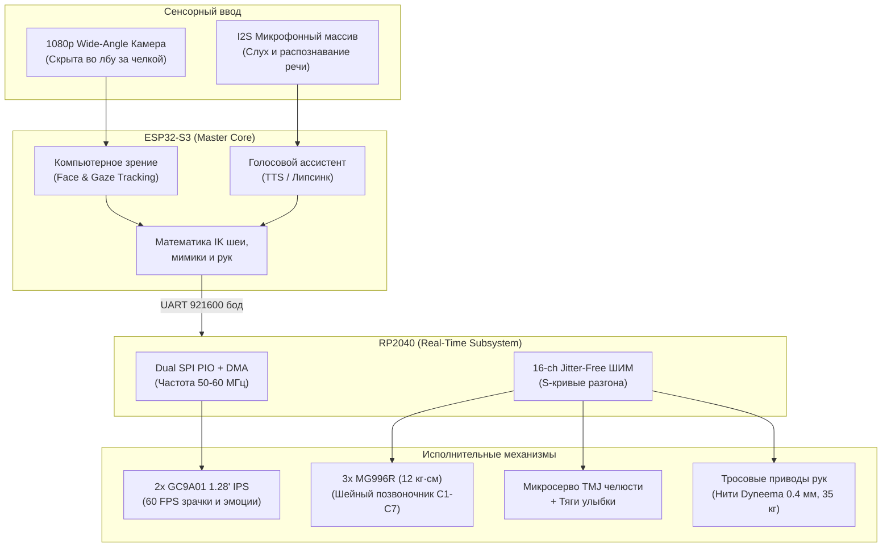

# Asuna Robotic Head & Modular Animatronic (v1)

> **СТАТУС ПРОЕКТА:** ⚠️ **КРАЙНЕ СЫРО / EARLY CONCEPT & IN-PROGRESS PROTOTYPE**  
> Проект находится на стадии активного НИОКР (R&D). Геометрия, кинематика и молды тестируются и дорабатываются.

Проект по созданию полноразмерного модульного аниматронного робота персонажа Асуны (*Yuuki Asuna*, Sword Art Online) в натуральную величину (масштаб 1:1, каноничный человеческий рост 168 см).

Основная цель — создать не угловатого промышленного робота, а робота с выразительной, живой пластикой и мимикой аниме-персонажа: круглые цифровые глаза на экранах, подвижная анатомическая челюсть для речи, естественная улыбка с обнажением зубов, поцелуй («губы в трубочку»), многозвенный позвоночник шеи, скрытые камеры технического зрения и тросовые руки на нитях Dyneema.

---

## Хроника разработки и требований пользователя

Вся разработка координируется через агентскую шину: [`шина.md`](шина.md). Ниже приведена хронология поставленных задач:

### Этап 1: Первичная декомпозиция бюста
- **Задача**: Достать голову и плечевой пояс из сырой 3D-модели Koikatu (`kk_Asuna/asuna.blend`).
- **Требования**:
  - Глаза в виде круглых экранов (GC9A01 1.28" IPS LCD) с анимированными зрачками и бликами.
  - Подвижная челюсть для синхронизации речи (lip-sync).
  - Подвижная шея и плечевой пояс.
  - Скрытое размещение камер технического зрения (без искажения аниме-эстетики лица).
  - Модульность конструкции: стандартизированный нижний фланец для последующего подключения туловища (торса) и боковые гнезда для рук.

### Этап 2: Аппаратная платформа, масштаб 1:1 и силиконовая кожа
- **Задача**: Адаптировать проект под реальную элементную базу пользователя и антропометрию.
- **Требования**:
  - **Масштаб 1:1 (рост 168.0 см)**: пересчет с масштабированием $S = 1.10964$ (+11%), высота головы 211.3 мм.
  - **Силовые сервоприводы MG996R**: применение имеющихся приводов с металлическим редуктором (10–12 кг·см) для силовой 3-DOF шеи и плечевых суставов.
  - **Связка ESP32-S3 + RP2040**:
    - *ESP32-S3*: компьютерное зрение, трекинг лиц, распознавание речи, обратная кинематика (IK).
    - *RP2040*: аппаратный драйвер двух круглых экранов GC9A01 по SPI PIO + DMA на 60 FPS и генератор ШИМ на 16 сервоприводов без дрожания (jitter-free).
  - **Литьевые молды под платиновый силикон**: разработка 3-составных форм под FDM-печать ($\le 220$ мм) для отливки мягкой силиконовой кожи лица (Dragon Skin / PlatSil Gel-10) с клиренсом 3.5–5 мм.
  - **Расширенная мимика**: анатомические зубные ряды, кинематика улыбки (подъем уголков губ), механика поцелуя (губы в трубочку), шевеление ушей (ear wiggle).

### Этап 3: Тросовые аниматронные руки и фиксация волос
- **Задача**: Реализация недорогих и легких манипуляторов, а также узла крепления парика.
- **Требования**:
  - **Тросовые руки на нитях (Dyneema cord)**: 5 подвижных пальцев с независимым сгибанием, 2-DOF лучезапястный сустав, локтевой шарнир.
  - **Фиксация волос**: черепной купол с неодимовыми магнитами (Ø8 мм) и периметральной канавкой под резинку парика, играющий роль съемного сервисного люка к электронике.
  - Аниматронные движения с аниме-выразительностью (жесты пальцами ✌️, 👉, 🫰, кулак, удержание меча).

### Этап 4: Полный отказ от примитивов в пользу биомиметической анатомии
- **Критика**: Первичные черновые примитивы (кубы, случайные палки, вертикально висящие трубки) отвергнуты как игрушечные.
- **Реализовано в версии v2**:
  - **Конформный череп (Conformal Skull)**: построен прямым эквидистантным сжатием полигональной сетки лица `KK Face` с отрицательным оффсетом 4 мм.
  - **Анатомическая нижняя челюсть**: мыщелковые отростки входят в суставные впадины височно-нижнечелюстного сустава (**TMJ**) на латунных втулках; верхний и нижний зубной ряд.
  - **Многозвенный шейный позвоночник (C1–C7)**: 4 позвонка Ball-and-Socket (Ø20 мм) с 4 сквозными каналами тросов Dyneema под приводы MG996R.
  - **Руки внутри рукавов**: каркас плеча, локтевой шкив, предплечье и пальцы проложены **строго по оси конечностей модели в T-позе**.

---

## Архитектура системы



---

## Структура репозитория

```
├── models/
│   ├── asuna_animatronic_master.blend   # Актуальная мастер-сцена Blender (v2)
│   ├── asuna_animatronic_head_bust.blend # Промежуточная сцена бюста
│   └── stl/                             # Каталог производственных STL (FDM <= 220 мм)
│       ├── 01_conformal_anatomical_skull.stl
│       ├── 02_anatomical_articulated_mandible.stl
│       ├── 03_dental_arch_maxilla.stl
│       ├── 04_cranium_magnetic_wig_dome.stl
│       ├── 05_biomimetic_cervical_spine_c1_c7.stl
│       ├── 06_anatomical_tendon_arm_left.stl
│       ├── 07_anatomical_tendon_arm_right.stl
│       ├── 08_silicone_mold_face_outer_left.stl
│       ├── 09_silicone_mold_face_outer_right.stl
│       └── 10_silicone_mold_inner_mandrel.stl
├── renders/                             # Сюита инженерных рендеров Cycles (1920x1080)
│   ├── 11_asuna_anatomical_front_xray.png
│   ├── 12_asuna_anatomical_threequarter.png
│   ├── 13_asuna_anatomical_head_jaw_detail.png
│   └── 14_asuna_tendon_arm_hand_detail.png
├── scripts/                             # Python-скрипты процедурной генерации в Blender
│   ├── build_full_anatomical_animatronic.py
│   ├── render_anatomical_master.py
│   └── master_build_animatronic.py
├── kk_Asuna/                            # Исходная аниме-модель персонажа
├── шина.md                              # Оперативная агентская шина проекта
└── README.md                            # Описание проекта
```

---

## Спецификация компонентов (BOM)

| Компонент | Назначение | Кол-во | Примечание |
|-----------|------------|--------|------------|
| **ESP32-S3-WROOM-1** | Главный контроллер, зрение, речь | 1 шт. | 16 МБ Flash, 8 МБ PSRAM |
| **RP2040 (Raspberry Pi Pico)** | Реалтайм-контроллер экранов и серво | 1 шт. | Dual Core 133 МГц |
| **GC9A01 1.28" Round IPS** | Цифровые анимированные глаза | 2 шт. | 240x240 RGB, SPI |
| **MG996R** | Силовые серво шеи и плеч | 3–5 шт. | Металлический редуктор, 10–12 кг·см |
| **MG90S / SG90** | Челюсть, улыбка, пальцы кистей | 8–12 шт. | 9 г микросерво |
| **OV5640 / Wide Angle 1080p** | Зрительная камера во лбу | 1 шт. | Угол обзора 110–120° |
| **Dyneema / PE Braided Cord** | Сухожильные тяги пальцев и шеи | 1 моток | Ø0.4 мм, прочность 35 кг |
| **Неодимовые магниты Ø8x2.5 мм** | Фиксация парика на куполе | 4 шт. | N52 никелированные |
| **Платиновый силикон** | Отливка маски кожи лица | 1 кг | PlatSil Gel-10 / Dragon Skin 10 |
| **PETG / ABS пластик** | 3D-печать силового каркаса | 1–2 кг | Высокая термо- и ударопрочность |

---

## Лицензия

Проект распространяется в исследовательских и образовательных целях. 3D-модели персонажа принадлежат правообладателям Sword Art Online / Reki Kawahara. Инженерные чертежи механизмов, код и схемотехника — Open Source.
